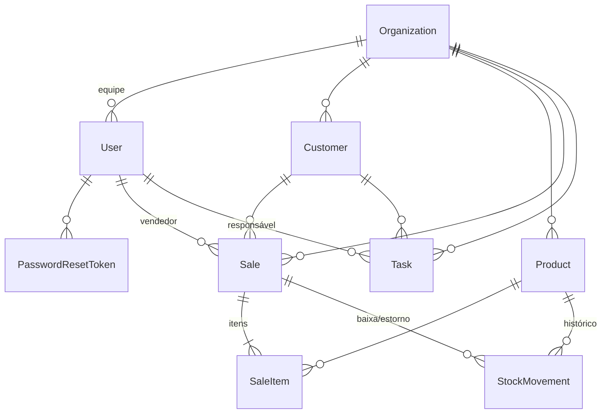

# Modelo de dados

PostgreSQL, gerenciado pelo Prisma (`server/prisma/schema.prisma` é a fonte de verdade; migrations em `server/prisma/migrations`).

| Tabela | Papel | Pontos importantes |
|---|---|---|
| `Organization` | Empresa (tenant) | Toda entidade de negócio tem `organizationId`; exclusão em cascata |
| `User` | Usuário da equipe | `email` único global; `role` (ADMIN/MANAGER/SELLER); `tokenVersion` revoga JWTs; `active` |
| `PasswordResetToken` | Recuperação de senha | Só o hash SHA-256 do token; `expiresAt`, `usedAt` |
| `Customer` | Cliente | Índice por (empresa, nome) para busca |
| `Product` | Produto/serviço | `sku` único por empresa; `price`/`cost` `DECIMAL(12,2)`; `stock`, `minStock`, `active` |
| `StockMovement` | Razão do estoque | `type` (IN, OUT, ADJUST, SALE, SALE_CANCEL), `quantity` com sinal, `balance` após o movimento |
| `Sale` | Venda | `number` sequencial por empresa (único); `subtotal`, `discount`, `total`, `cost` (CMV na data); `status` + `paidAt`/`canceledAt` |
| `SaleItem` | Item da venda | Snapshot de `name`, `unitPrice` e `unitCost` (relatórios não mudam se o cadastro mudar) |
| `Task` | Tarefa | `status`, `priority`, `dueDate`, `completedAt`, responsável e cliente opcionais |

Decisões:

- **Dinheiro em `DECIMAL`**, nunca ponto flutuante, com cálculo em `Prisma.Decimal` no servidor.
- **Estoque nunca é editado diretamente**: só por movimentações ou vendas, sempre em transação com `SELECT … FOR UPDATE`. O histórico explica qualquer saldo.
- **Histórico preservado**: excluir cliente/usuário mantém as vendas (`SET NULL`); produto com vendas é desativado, não excluído.
